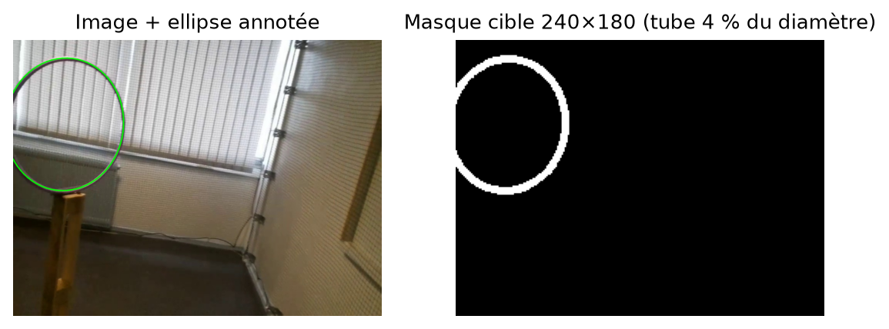
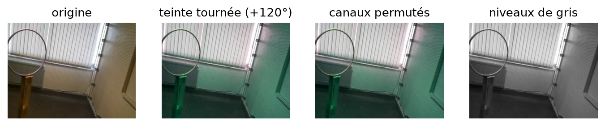
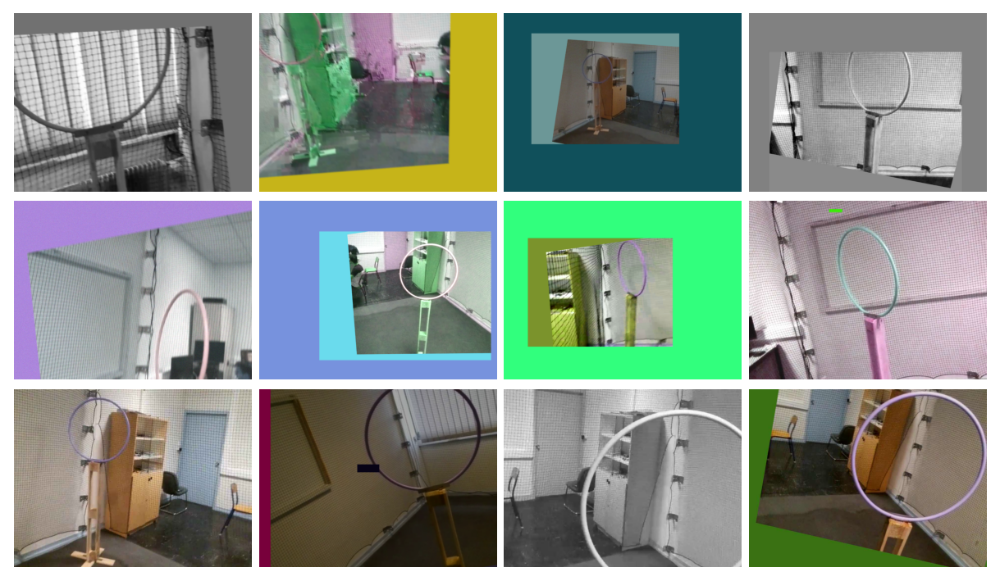
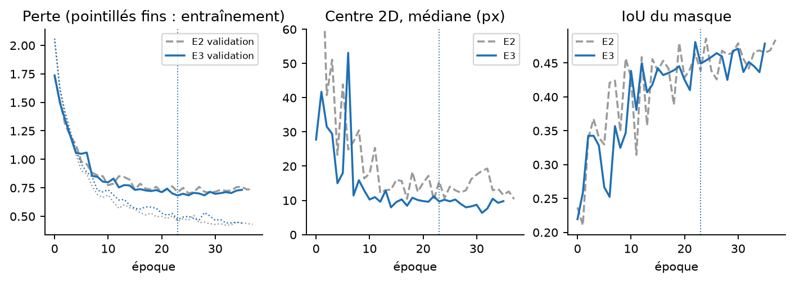
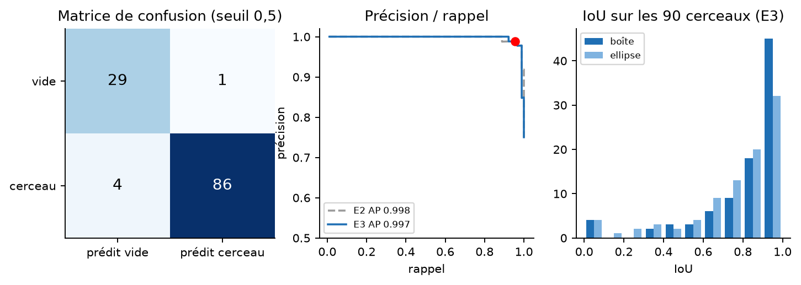
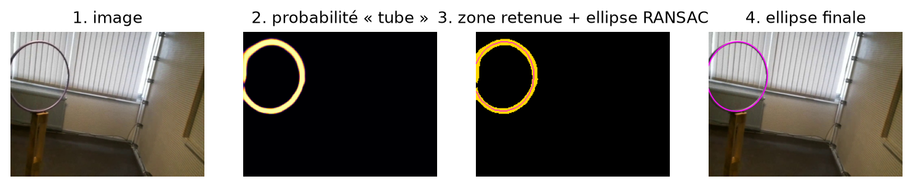
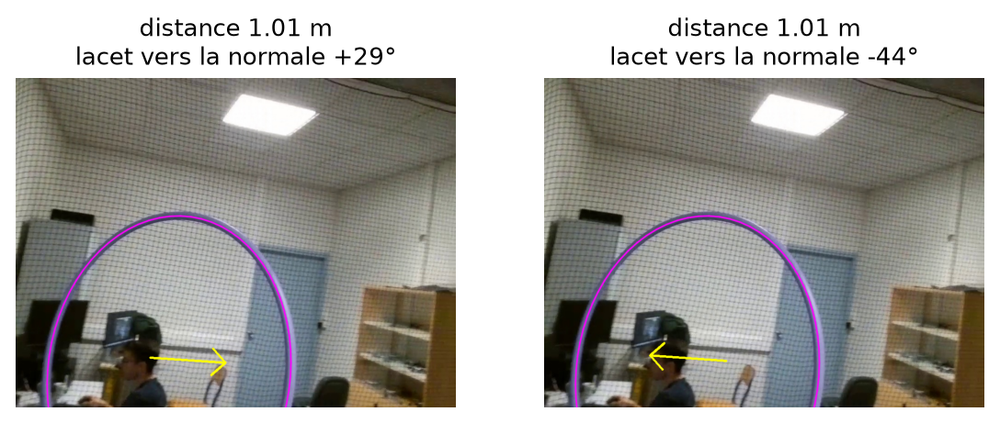
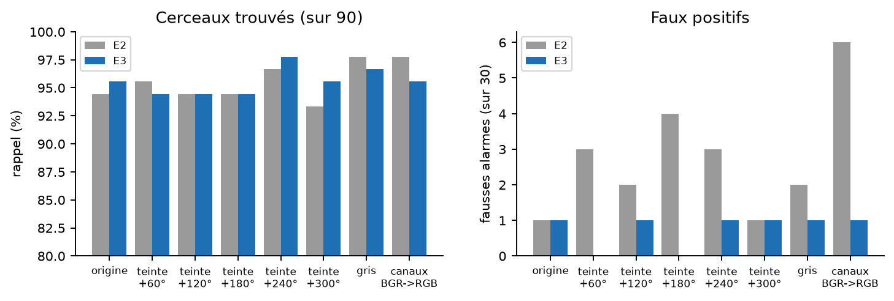
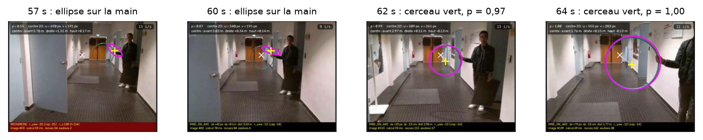
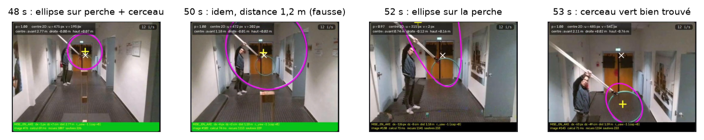

# Modèle E3 : segmentation de l'anneau insensible à la couleur et localisation 2D / 3D du cerceau

Résumé complet : pourquoi E3, données et augmentations de couleur, architecture du CNN, entraînement, meilleure époque, métriques comparées à E2, robustesse à la couleur, essais en vol avec le cerceau vert, passage du masque aux coordonnées 2D puis 3D.

Partie vision du projet de vol autonome d'un drone Tello.
Modèle : `logs/E3_segmentation480_couleur_0` · config : `configs/E3_segmentation480_couleur.yaml` · code : `~/Documents/tello/tellovision` · rapport du 14/10/2026.

Version PDF : `docs/rapport_E3_segmentation_couleur.pdf`. Figures et scripts de génération : `docs/rapport_E3_sources/`.

## Fiche d'identité

| Élément | Valeur |
|---|---|
| Nom de l'expérience | E3_segmentation480_couleur (dossier `logs/E3_segmentation480_couleur_0`) |
| Différence avec E2 | Une seule : trois augmentations de couleur à l'entraînement (teinte tournée sur tout le cercle, canaux permutés, niveaux de gris). Données, réseau, perte, réglages et validation identiques. |
| Pourquoi | Un deuxième cerceau, vert, était mal détecté en vol : le réseau ne devait plus dépendre de la couleur. |
| Tâche | Segmentation de l'anneau + présence, puis ajustement d'ellipse et pose 3D |
| Modèle | RingSegNet : encodeur MobileNetV3-small pré-entraîné (ImageNet) + décodeur U-Net |
| Entrée / sortie | Image 480×360 → masque 240×180 + probabilité de présence |
| Paramètres | 1,67 million (encodeur 0,93 M, décodeur 0,74 M, tête de présence 577) |
| Données | 615 images : 495 d'entraînement (284 cerceaux, 211 vides), 120 de validation (90 / 30) |
| Meilleure époque | 23 (sur 36 effectuées, 0 à 35 ; arrêt anticipé après l'époque 35) |
| Perte de validation retenue | 0,6827 (E2 : 0,7016) |
| Présence (validation) | exactitude 95,8 %, précision 98,9 %, rappel 95,6 %, F1 0,972, AP 0,997 |
| Boîte englobante (validation) | IoU médiane 0,90 ; 90 % des images à IoU ≥ 0,5 ; AP@0,5 = 0,89 (E2 : 0,80) |
| Centre 2D (validation) | médiane 9,7 px (cage : 4,9 px) ; moyenne 22,2 px |
| Distance 3D | cage : erreur médiane 1,7 % (4 cm) ; couloir : 10,3 % (E2 : 15,6 %) |
| Robustesse à la couleur | Validation recolorée (7 variantes) : 5 fausses alarmes sur 210 images vides pour E3, 21 pour E2 ; rappel identique (94 à 98 %) |
| Temps de calcul (CPU) | 66 ms par image : CNN 54 ms + ellipse 11 ms + pose 0,5 ms (≈ 15 images/s) |
| Verdict | E3 remplace E2 en vol (vision_node, voir_mqtt, live_detect, detector par défaut). |

## 1. Pourquoi E3

E2 a été entraîné uniquement avec le cerceau violet de la cage (et quelques cerceaux gris du couloir). Son augmentation de couleur ne faisait varier la teinte que de ±4 unités OpenCV (±8° sur 360°) : le réseau pouvait donc s'appuyer sur la couleur du tube. Lors des essais du 14/10 avec un second cerceau, vert, la détection était difficile. Deux solutions : filmer et annoter le cerceau vert, ou rendre le réseau insensible à la couleur. E3 teste la seconde, qui ne demande aucune annotation.

Principe : à l'entraînement, la couleur des images est changée au hasard (teinte, ordre des canaux, niveaux de gris). Le cerceau prend toutes les couleurs, le fond aussi ; la seule chose stable d'une image à l'autre est la forme de l'anneau. Tout le reste est identique à E2, ce qui permet une comparaison directe.

| Modèle (même validation stable) | Présence | Centre médian | Grand axe médian | B/A |
|---|---|---|---|---|
| E0 – régression 320×240 | 89,2 % | 68 px | 16,6 % | 0,082 |
| E1 – régression 480×360 | 90,8 % | 78 px | 28,1 % | 0,086 |
| E2 – segmentation 480×360 | 95,0 % | 9,2 px | 3,9 % | 0,083 |
| E3 – segmentation 480×360, couleur | 95,8 % | 9,7 px | 3,0 % | 0,074 |

E2 et E3 sont évalués ici avec exactement la même chaîne (même passage masque → ellipse, même validation) : les chiffres d'E2 de ce tableau sont ceux de son rapport.

## 2. Les données

### 2.1 Jeu de données et découpage

Inchangé par rapport à E2. 615 images de la caméra du Tello (960×720), prises dans le couloir (cerceaux gris, 2,7 à 5,5 m) et dans la cage (cerceau violet de 68 cm, 0,9 à 3,1 m) : 374 avec cerceau, 241 vides. Règle d'annotation : si moins d'un tiers du cerceau est visible, l'image est vide. Chaque cerceau est annoté par une ellipse (centre, grand axe, petit axe, inclinaison), qui peut déborder de l'image.

Découpage stable : chaque image appartient à une tranche de 5 s (horodatage du nom), et le côté de la tranche est fixé par un hachage (CRC32) de son numéro avec la graine 0. Résultat : 495 images d'entraînement (284 cerceaux, 211 vides) et 120 de validation (90 cerceaux dont 51 de la cage et 39 du couloir, 30 vides). **Aucune image du cerceau vert n'est dans ces données.**

### 2.2 Prétraitement

- redimensionnement en 480×360 (rapport 4:3 conservé) ;
- passage de BGR (OpenCV) à RGB, valeurs ramenées dans [0, 1] puis normalisées avec la moyenne (0,485 ; 0,456 ; 0,406) et l'écart-type (0,229 ; 0,224 ; 0,225) d'ImageNet. Cette conversion est la même à l'entraînement, à la validation et en vol (`detector.py`) ;
- tenseur (canaux, hauteur, largeur) : un lot de 16 images est un tenseur (16, 3, 360, 480).

### 2.3 Le masque cible

Le réseau apprend à reproduire un masque de l'anneau, dessiné automatiquement à partir de l'ellipse annotée : l'ellipse est ramenée à la résolution du masque (240×180, pas de 2) et tracée avec une épaisseur de 4 % du diamètre (tube de 2,5 cm sur 68 cm), au minimum 2 pixels. Une image vide a un masque noir ; une « corde » (arc trop court) a un masque inconnu, ignoré par la perte.



*Figure 1 – Masque cible dessiné à partir de l'ellipse annotée.*

### 2.4 Augmentations (entraînement seulement)

| Transformation | Probabilité | Paramètres | Rôle |
|---|---|---|---|
| Miroir horizontal | 0,5 | — | Cerceau vu de l'autre côté |
| Rotation de caméra H = K R K⁻¹ | 0,6 | lacet ±12°, tangage ±8°, roulis ±12° ; K de la calibration | Le drone tourne ; ellipse transformée exactement |
| Zoom + décalage | 0,5 | échelle 0,6 à 1,3 ; décalage ±15 % | Distance et position variées |
| Visibilité minimale | — | au moins 34 % du contour dans l'image | Cohérent avec la règle du tiers |
| Couleur / lumière | 0,8 | luminosité ±35 %, contraste ±30 %, saturation ±40 %, teinte ±4 | Contre-jour, exposition |
| **NOUVEAU – Teinte tournée** | **0,5** | teinte décalée d'une valeur tirée sur tout le cercle (0 à 360°) | Cerceau vert, bleu, jaune… : la couleur ne renseigne plus |
| **NOUVEAU – Canaux permutés** | **0,3** | ordre B, G, R tiré au hasard | Autre façon de changer la couleur |
| **NOUVEAU – Niveaux de gris** | **0,2** | image convertie en gris (3 canaux identiques) | Reconnaître le cerceau à sa forme seule |
| Flou de bougé | 0,3 | noyau ≤ 11 px | Mouvement du drone |
| Bruit | 0,3 | écart-type ≤ 8 | Capteur |
| Rectangle masqué | 0,3 | côté ≤ 15 % de l'image | Occultation |
| Compression JPEG | 0,5 | qualité 35 à 80 | Flux Wi-Fi |
| Collage sur un autre fond | 0 | désactivé | Créait des anneaux « fantômes » |

Les trois nouvelles augmentations sont appliquées après la couleur / lumière, indépendamment les unes des autres : environ 72 % des images d'entraînement ont une couleur modifiée en plus du réglage de lumière. Elles sont codées dans `tellovision/data.py` (`hue_rotate`, `channel_shuffle`, `grayscale`) et désactivées si la configuration ne les mentionne pas : E0, E1 et E2 se réentraînent à l'identique. La validation n'a **aucune** augmentation.



*Figure 2 – Les trois augmentations de couleur sur une même image de la cage.*



*Figure 3 – Exemples d'images d'entraînement d'E3 après augmentation : le cerceau violet apparaît rose, bleu, vert, blanc ou gris.*

## 3. Le réseau RingSegNet

Identique à E2 (seuls les poids changent). Le réseau a la forme d'un U : un encodeur réduit l'image en cartes de caractéristiques de plus en plus abstraites et de moins en moins résolues ; un décodeur remonte la résolution en réutilisant les cartes de l'encodeur (connexions de saut) pour retrouver le détail fin du tube. Deux têtes répondent aux deux questions : y a-t-il un cerceau, et où est le tube.

```
image (3, 360, 480)
  │ ENCODEUR MobileNetV3-small (pré-entraîné ImageNet)
  ├─ bloc 0  ─► (16, 180, 240)  pas 2  ──────────────────────────┐
  ├─ bloc 1  ─► (16, 90, 120)   pas 4  ─────────────────────┐    │
  ├─ bloc 3  ─► (24, 45, 60)    pas 8  ────────────────┐    │    │
  ├─ bloc 8  ─► (48, 23, 30)    pas 16 ───────────┐    │    │    │
  └─ bloc 12 ─► (576, 12, 15)   pas 32            ▼    ▼    ▼    ▼
        ├─ TÊTE DE PRÉSENCE : moyenne globale → 576 → Dropout 0,2 → Linear → 1 logit
        └─ DÉCODEUR : up1 (96,23,30) → up2 (48,45,60) → up3 (32,90,120) → up4 (24,180,240)
                      → Conv 1×1 → MASQUE (1, 180, 240) = logits « tube » par pixel
```

### 3.1 L'encodeur : MobileNetV3-small

Réseau conçu pour les téléphones : peu de calculs, mais pré-entraîné sur 1,2 million d'images (ImageNet), il reconnaît déjà bords, textures et formes. Ses 13 blocs sont faits de :

- une convolution d'entrée 3×3 de pas 2 (16 filtres), normalisation par lot, activation hard-swish (version rapide de x·sigmoïde(x)) ;
- blocs « résiduels inversés » : convolution 1×1 qui augmente le nombre de canaux, convolution en profondeur 3×3 ou 5×5 (un filtre par canal), module squeeze-and-excitation (moyenne globale de chaque canal → petite couche dense → poids qui renforcent les canaux utiles), convolution 1×1 de projection, connexion résiduelle quand les dimensions le permettent ;
- une convolution finale 1×1 vers 576 canaux (hard-swish).

La résolution est divisée par 2 cinq fois, par des convolutions de pas 2 (pas de max-pooling). On prélève les sorties des blocs 0, 1, 3, 8 et 12, aux pas 2, 4, 8, 16 et 32.

### 3.2 Le décodeur U-Net

Chaque bloc de remontée (UpBlock) : interpolation bilinéaire jusqu'à la taille de la carte de l'encodeur correspondante, concaténation avec elle, puis deux fois (convolution 3×3 + normalisation par lot + ReLU). Une dernière convolution 1×1 produit un logit par pixel.

| Bloc | Entrées (canaux) | Sortie | Paramètres |
|---|---|---|---|
| up1 | 576 (pas 32) + 48 (pas 16) | (96, 23, 30) | 622 k |
| up2 | 96 + 24 (pas 8) | (48, 45, 60) | 73 k |
| up3 | 48 + 16 (pas 4) | (32, 90, 120) | 28 k |
| up4 | 32 + 16 (pas 2) | (24, 180, 240) | 16 k |
| Tête du masque | Conv 1×1, 24 → 1 | (1, 180, 240) | 25 |

### 3.3 La tête de présence (classification)

Moyenne globale de la carte la plus profonde (576×12×15 → 576 valeurs), Dropout de 0,2, puis une couche dense vers 1 logit ; la probabilité de présence est la sigmoïde de ce logit. La présence est une question globale : la position n'importe pas. Pour la localisation au contraire, toute l'information spatiale est gardée par le décodeur.

| Où | Opération | Rôle |
|---|---|---|
| Encodeur (descente) | Convolutions de pas 2 | Réduire la résolution, agrandir le champ réceptif |
| Modules squeeze-and-excitation | Moyenne globale par canal | Pondérer les canaux |
| Décodeur (remontée) | Interpolation bilinéaire + connexions de saut | Retrouver le détail fin |
| Tête de présence | Moyenne globale + Dropout 0,2 | Décision globale, limiter le surapprentissage |
| Partout | Normalisation par lot | Stabiliser l'apprentissage |

## 4. La perte

```
perte = BCE(présence)                 poids des positifs : 1
      + 1 × BCE(masque) pondérée      poids des pixels « tube » : 10
      + 1 × Dice(masque)              images contenant un anneau seulement
(perte de masque ignorée pour les « cordes », dont le masque est inconnu)
```

L'anneau n'occupe que quelques pour cent des pixels : avec une entropie croisée simple, prédire « fond » partout donnerait déjà une perte faible ; on multiplie donc par 10 le poids des pixels du tube. La perte de Dice mesure directement le recouvrement entre masque prédit P et masque vrai T :

Dice = 1 − (2·Σ P·T + 1) / (Σ P + Σ T + 1)

Elle vaut 0 pour un recouvrement parfait et ne dépend pas du nombre de pixels de fond. Inchangée par rapport à E2.

## 5. L'entraînement

| Réglage | Valeur |
|---|---|
| Optimiseur | AdamW, pas 10⁻³ pour le décodeur et les têtes, 10⁻⁴ pour l'encodeur (× 0,1), pénalité des poids 10⁻⁴ |
| Calendrier du pas | Cosinus sur 50 époques : pas = pas initial × (1 + cos(π·époque/50)) / 2 |
| Lot | 16 images |
| Nombre d'époques | 50 au maximum ; arrêt anticipé après 12 époques sans amélioration |
| Choix du meilleur modèle | Plus petite perte de validation |
| Graine aléatoire | 0 |
| Matériel | CPU (pas de GPU), environ 102 s par époque, 59 minutes au total (E2 : 80 s, 50 min) ; les conversions de couleur ajoutent un peu de travail au chargement des images |
| Commande | `python -m tellovision.main configs/E3_segmentation480_couleur.yaml train` |



*Figure 4 – Courbes d'apprentissage d'E3 (bleu) et d'E2 (gris). Le pointillé vertical marque l'époque retenue (23). Attention : les erreurs de centre d'E2 sur ce graphique ont été calculées pendant son entraînement avec la première version du passage masque → ellipse (§7), moins bonne ; elles ne sont pas comparables à celles d'E3. La comparaison juste est celle du §6, avec la même chaîne pour les deux.*

**Meilleure époque : 23**, avec une perte de validation de 0,6827 (E2 : 0,7016 à l'époque 25). Ensuite la perte de validation stagne (0,70 à 0,73) pendant que la perte d'entraînement continue de baisser (0,56 → 0,44) : le réseau commence à sur-apprendre, et l'arrêt anticipé s'est déclenché après l'époque 35. Le modèle enregistré est celui de l'époque 23, pas le dernier.

Sur toute la fin de l'entraînement (époques 15 à 35), la perte de validation d'E3 reste sous celle d'E2 (moyenne 0,712 contre 0,735) : les augmentations de couleur jouent aussi un rôle de régularisation.

## 6. Métriques et résultats (validation stable, 120 images)

Toutes les mesures portent sur les 120 images de validation (90 avec cerceau, 30 sans), jamais vues pendant l'entraînement et séparées par tranches de 5 s pour éviter les quasi-doublons. E2 est recalculé avec la même chaîne pour comparaison ; ses chiffres retrouvent exactement ceux de son rapport.

### 6.1 Définitions des métriques

**Présence (classification).** Le réseau donne une probabilité p ; on décide « cerceau » si p ≥ 0,5. Chaque image tombe dans une des quatre cases de la matrice de confusion :

| Case | Signification | Conséquence pour le drone |
|---|---|---|
| VP (vrai positif) | cerceau présent, détecté | — |
| FN (faux négatif) | cerceau présent, raté | le drone continue à chercher : perte de temps |
| FP (faux positif) | rien, mais cerceau annoncé | le drone vise un objet qui n'existe pas : dangereux |
| VN (vrai négatif) | rien, et rien annoncé | — |

- **Exactitude** = (VP + VN) / total : part des images bien classées (trompeuse si les classes sont déséquilibrées, ici 90 / 30).
- **Précision** = VP / (VP + FP) : quand le modèle annonce un cerceau, peut-on le croire ? Métrique de sécurité.
- **Rappel** = VP / (VP + FN) : parmi les vrais cerceaux, combien sont trouvés ?
- **Spécificité** = VN / (VN + FP) : parmi les images vides, combien sont reconnues vides ?
- **F1** = 2 · précision · rappel / (précision + rappel).
- **AP** (average precision) : aire sous la courbe précision / rappel obtenue en faisant varier le seuil ; juge le modèle indépendamment du seuil (1 = parfait).

**Localisation.** Le recouvrement entre forme prédite et forme de référence se mesure par l'IoU (Intersection over Union) = aire commune / aire totale couverte (1 = identiques). On le calcule sur le masque (pixels « tube »), la boîte englobante et l'ellipse pleine. S'y ajoutent les erreurs utiles au vol : erreur du centre (px), erreur relative du grand axe (elle se transmet telle quelle à la distance), erreur du rapport B/A (orientation du cerceau) et erreur d'inclinaison de l'ellipse (degrés, ellipses aplaties B/A < 0,85).

### 6.2 Présence



*Figure 5 – Gauche : matrice de confusion d'E3 au seuil 0,5. Milieu : courbes précision / rappel d'E3 et d'E2 (point rouge : seuil 0,5). Droite : IoU boîte et ellipse sur les 90 images avec cerceau (une image sans prédiction compte 0).*

| Métrique | E3 | E2 | Lecture (E3) |
|---|---|---|---|
| Matrice de confusion | VP 86 · FN 4 · FP 1 · VN 29 | VP 85 · FN 5 · FP 1 · VN 29 | 5 erreurs sur 120 |
| Exactitude | 95,8 % | 95,0 % | 115 images sur 120 |
| Précision | 98,9 % | 98,8 % | 1 seule fausse alarme (la même image pour les deux) |
| Rappel | 95,6 % | 94,4 % | 4 cerceaux ratés |
| Spécificité | 96,7 % | 96,7 % | 29 images vides sur 30 |
| F1 | 0,972 | 0,966 | |
| AP (aire sous P/R) | 0,997 | 0,998 | les probabilités classent presque parfaitement les images |

E3 rate un cerceau de moins qu'E2 ; les quatre cerceaux ratés le sont aussi par E2 (p = 0,29, 0,23, 0,39, 0,02) : deux cerceaux lointains du couloir et deux très coupés de la cage. La seule fausse alarme est la même image vide du couloir pour les deux modèles, avec une probabilité plus basse pour E3 (0,60 contre 0,80). Sur 1 ou 2 images, ces écarts restent dans le bruit : la détection est équivalente. En vol, la confirmation sur 5 images consécutives élimine en plus les fausses alarmes isolées.

### 6.3 Localisation 2D

| Mesure | E3 toutes | E3 cage | E3 couloir | E2 toutes | E2 cage | E2 couloir |
|---|---|---|---|---|---|---|
| IoU du masque | 0,45 | — | — | 0,44 | — | — |
| Centre 2D, médiane (px) | 9,7 | 4,9 | 24,1 | 9,2 | 3,9 | 23,9 |
| Centre 2D, moyenne (px) | 22,2 | 12,6 | 34,9 | 21,9 | 12,9 | 33,5 |
| Centres à plus de 50 px | 8 | 3 | 5 | 12 | 4 | 8 |
| Grand axe (≈ distance), médiane | 3,0 % | 1,7 % | 11,3 % | 3,9 % | 1,7 % | 13,7 % |
| Grand axe, moyenne | 14,4 % | 4,0 % | 28,0 % | 13,2 % | 3,9 % | 25,2 % |
| Rapport B/A, erreur moyenne | 0,074 | 0,037 | 0,123 | 0,083 | 0,041 | 0,139 |
| Inclinaison (ellipses aplaties), médiane | 20,1° (26) | 8,9° (9) | 28,2° (17) | 27,2° (26) | 9,5° (9) | 61,7° (17) |

Lecture honnête : avec la même chaîne, **le centre 2D est équivalent** (9,7 contre 9,2 px en médiane ; dans la cage 4,9 contre 3,9 px, soit un pixel d'écart). E3 fait en revanche **moins de grosses erreurs** (8 centres à plus de 50 px contre 12), mesure mieux la **taille** (grand axe médian 3,0 % contre 3,9 %), la **forme** (B/A 0,074 contre 0,083) et surtout **l'orientation** des ellipses aplaties du couloir (28° contre 62°). Ce dernier point compte pour la pose 3D (§8.5).

> **Correction d'une conclusion précédente.** Pendant l'entraînement, TensorBoard montrait un écart bien plus grand (centre moyen 19 contre 44 px, grand axe 12 contre 35 %). Cet écart venait surtout de la version du passage masque → ellipse utilisée au moment de chaque entraînement : celle d'E2 était l'ancienne. Avec la même chaîne, le gain réel d'E3 est celui de ce tableau.

### 6.4 Boîtes englobantes

Une boîte englobante est le plus petit rectangle aligné sur les axes qui contient l'objet (x1, y1, x2, y2), la sortie des détecteurs classiques (YOLO, SSD, Faster R-CNN). E3, comme E2, ne prédit pas de boîte mais une ellipse (5 nombres : centre, deux demi-axes, angle), qui contient toute l'information de la boîte et en plus l'orientation du cerceau, indispensable à la pose 3D. La boîte s'en déduit (`ellipse_bbox`) : demi-largeur w = √(A²cos²θ + B²sin²θ), demi-hauteur h = √(A²sin²θ + B²cos²θ). La boîte de référence est déduite de la même façon de l'ellipse annotée, puis limitée au cadre de l'image.

| Métrique (90 images avec cerceau) | E3 boîte visible | E3 boîte amodale | E3 ellipse pleine | E2 boîte visible |
|---|---|---|---|---|
| IoU moyen | 0,81 | 0,75 | 0,75 | 0,76 |
| IoU médian | 0,90 | 0,83 | 0,84 | 0,91 |
| Part des images à IoU ≥ 0,5 | 90 % | 88 % | 87 % | 83 % |
| Part des images à IoU ≥ 0,75 | 71 % | 63 % | 61 % | 66 % |
| AP@0,5 (style détecteur) | 0,89 | — | — | 0,80 |
| AP@0,75 | 0,67 | — | — | 0,59 |

- **AP@0,5** : métrique classique des détecteurs (PASCAL VOC). Une détection est juste si p ≥ seuil et IoU de boîte ≥ 0,5 ; on trie les détections par probabilité et on calcule l'aire sous la courbe précision / rappel. AP@0,75 est la version exigeante.
- **Boîte amodale** : boîte de l'ellipse entière, partie hors image comprise (plus sévère).
- E3 gagne nettement en AP@0,5 (0,89 contre 0,80) et en part d'images à IoU ≥ 0,5 (90 % contre 83 %) : moins de cerceaux mal placés. Le pic de la distribution (figure 5, droite) est entre 0,9 et 1 ; les IoU nulles sont les 4 cerceaux ratés.

## 7. Du masque aux coordonnées 2D



*Figure 6 – La chaîne d'E3 sur une image de la cage. 2 : probabilité « tube » prédite. 3 : zone retenue (jaune) et ellipse RANSAC (magenta). 4 : résultat final.*

### 7.1 Ajuster l'ellipse sur le masque

- **Seuil** : on garde les pixels de probabilité ≥ 0,5.
- **Plus grande zone connexe seulement** : les petites taches isolées sont du bruit.
- **Candidat A – RANSAC** : 150 fois, on tire 5 pixels, on ajuste une ellipse (`cv2.fitEllipse`) et on compte les pixels à moins de 4 % de son contour ; on garde la meilleure et on la réajuste sur ses pixels proches. Efficace quand le masque est un anneau ou un arc.
- **Candidat B – contour extérieur** : ellipse ajustée sur le bord extérieur de la zone, réduite d'une demi-épaisseur de tube. Efficace pour les petits cerceaux, dont le masque devient une tache pleine.
- **Choix** : la candidate qui passe sur les pixels les plus probables (probabilité moyenne sur 128 points de son contour).
- **Changement de repère** : du masque (240×180) à l'image (960×720), facteur 4 sur les centres de pixels.

Limite vue en vol (§10) : quand la plus grande zone du masque n'est pas le cerceau (main, perche, manche sombre), l'ellipse est ajustée sur ce fragment et donne une ellipse plate, au mauvais endroit.

### 7.2 Le centre 2D du cerceau n'est pas le centre de l'ellipse

Par la perspective, la moitié la plus proche du cerceau paraît plus grande : le centre de l'ellipse n'est pas l'image du centre du cerceau. Le centre 2D renvoyé (u, v) est donc la projection du centre 3D (§8), distorsion comprise. Dans la validation de la cage, l'écart vaut 5,6 px en médiane et jusqu'à 48 px, de près et de biais.

## 8. Des coordonnées 2D à la 3D

Cette partie géométrique est commune à E2 et E3 : elle ne dépend que de l'ellipse.

### 8.1 La calibration de la caméra

| Grandeur | Valeur | Sens |
|---|---|---|
| Focales fx, fy | 927,1 et 925,8 px | Conversion angle ↔ pixels |
| Centre optique cx, cy | 475,8 ; 386,3 px | Point de l'image dans l'axe de la caméra |
| Distorsion k1, k2, p1, p2, k3 | −0,015 ; 0,035 ; 0,002 ; 0,002 ; 0,034 | Très faible |
| Erreur de reprojection | 0,23 px sur 39 images de damier | Très bonne calibration |
| Champ de vision | 54,7° × 42,5° (65,9° en diagonale) | Le flux 960×720 n'utilise que le centre du capteur |
| Inclinaison de la caméra | 10,3° vers le bas (`configs/drone.yaml`) | Passage repère caméra → repère drone |

Avant le calcul, la distorsion est corrigée : 72 points du contour de l'ellipse sont redressés (`cv2.undistortPoints`) et l'ellipse est réajustée.

### 8.2 Du cercle vu en ellipse au cercle 3D

Chaque point de l'ellipse correspond à un rayon issu de la caméra : ces rayons forment un cône. Si C est la matrice de la conique de l'ellipse (pixels) et K la matrice de la caméra, le cône a pour équation XᵀQX = 0 avec Q = KᵀCK. On diagonalise Q : valeurs propres λ1 ≥ λ2 > 0 > λ3, vecteurs propres en colonnes de V. Seuls deux plans coupent ce cône selon un cercle de rayon r = 0,34 m :

```
a = √((λ1 − λ2) / (λ1 − λ3))     b = √((λ2 − λ3) / (λ1 − λ3))     s = ±1 (deux solutions)
normale  n = V · [ s·a, 0, −b ]
centre   c = r / √(−λ1·λ3) · V · [ s·a·λ3, 0, −b·λ1 ]
signes fixés pour que le cerceau soit devant la caméra (c_z > 0) et que la normale
pointe dans le sens de la traversée (n_z > 0)
```

Référence : Chen, Wu, Wada, « Camera calibration with two arbitrary coplanar circles », ECCV 2004. Vérification sur 500 cercles simulés : erreur maximale de 0,4 mm sur le centre et 0,13° sur la normale ; toute l'erreur finale vient du réseau. **Attention** : le diamètre (`configs/hoop.yaml`, 0,68 m) est celui du cerceau violet ; un cerceau vert de diamètre différent fausse toutes les distances dans le même rapport.

### 8.3 Les grandeurs renvoyées

| Grandeur | Calcul | Utilisation |
|---|---|---|
| Centre 3D (x, y, z) | c, en mètres ; x à droite, y vers le BAS, z devant | Position du cerceau |
| Repère drone (avant, droite, haut) | c tourné de l'inclinaison de la caméra | delta_z, distance envoyés au PC de contrôle |
| Distance | ‖c‖ | Phase d'approche, passage en TRAVERSEE |
| Centre 2D (u, v) | projection de c par la calibration | delta_x (pixels) envoyé au PC de contrôle |
| Normale n | vecteur unitaire, sens de la traversée | Direction d'entrée |
| Lacet vers la normale | atan2(nx, nz) | Se placer face au cerceau |
| Angle de vue | acos(nz) | Écart à l'axe du cerceau |

### 8.4 L'ambiguïté double



*Figure 7 – Frame 0459 avec E3 : les deux solutions ont le même centre (1,01 m) mais deux orientations, tournées de +29° et −44°.*

Une ellipse correspond à deux orientations possibles du cercle, comme une pièce tournée à gauche ou à droite. Règles de choix : (1) suivi d'une image à l'autre (normale la plus proche de la précédente) ; (2) sinon cerceau vertical, donc normale horizontale. Quand les deux restent proches, le résultat est marqué « ambigu ». L'ambiguïté disparaît quand le drone s'aligne (B/A = 1). En vol, la mise en axe actuelle n'utilise que le centre (delta_x, delta_z, distance), pas la normale : l'ambiguïté ne gêne pas le guidage.

### 8.5 Précision 3D

Référence : la pose calculée à partir de l'ellipse annotée, comparée à celle calculée à partir de l'ellipse prédite.

| Mesure (médiane) | E3 cage | E2 cage | E3 couloir | E2 couloir |
|---|---|---|---|---|
| Plage de distance | 0,9 à 3,1 m | idem | 2,7 à 5,5 m | idem |
| Distance | 1,7 % (4 cm) | 1,6 % (3 cm) | 10,3 % (33 cm) | 15,6 % (44 cm) |
| Centre 3D | 4,7 cm, dont 1,0 cm latéralement | 3,6 cm, dont 1,1 cm | 33 cm | 44 cm |
| Centre 2D (u, v) | 5,3 px | 5,2 px | 19,4 px | 21,2 px |
| Normale | 7,0° (19° pour 10 % des cas) | 6,5° (24°) | 24° | 32° |

Dans la cage, E3 et E2 sont équivalents (distance à 1,6-1,7 %, soit 3 à 4 cm). Dans le couloir, plus loin et à contre-jour, E3 est nettement meilleur : distance 10 % au lieu de 16 % (33 cm au lieu de 44 cm), normale 24° au lieu de 32°. Les cas extrêmes de la normale dans la cage sont aussi réduits (19° contre 24° pour 10 % des cas).

> **Limites à connaître pour le guidage.** Près de l'axe du cerceau, B/A ≈ cos(angle de vue) varie très peu : une erreur de 0,04 sur B/A laisse l'angle entre 0 et environ 16° ; en fin d'approche, mieux vaut s'appuyer sur le centre que sur la normale. Le cerceau ne tient plus entièrement dans l'image en dessous d'environ 0,87 m : le dernier mètre se fait à l'aveugle. Enfin, la caméra voit jusqu'à environ 31° sous l'horizontale (21° de demi-champ + 10° d'inclinaison) : un cerceau nettement plus bas que le drone sort de l'image par le bas pendant l'approche.

## 9. Robustesse à la couleur

Pour mesurer ce que les augmentations ont apporté sans images du cerceau vert, la validation est **recolorée** : la teinte de chaque image est décalée de 60 en 60° (le cerceau violet devient rouge, jaune, vert, cyan, bleu), convertie en gris, ou ses canaux B et R sont inversés. Les 120 images restent annotées : on mesure le rappel sur les 90 cerceaux et les fausses alarmes sur les 30 images vides, pour E2 et E3.



*Figure 8 – Validation recolorée. Gauche : part des 90 cerceaux trouvés. Droite : fausses alarmes sur les 30 images vides.*

| Variante | E2 rappel | E2 fausses alarmes | E2 centre méd. | E3 rappel | E3 fausses alarmes | E3 centre méd. |
|---|---|---|---|---|---|---|
| origine | 94,4 % | 1 / 30 | 9,2 px | 95,6 % | 1 / 30 | 9,7 px |
| teinte +60° | 95,6 % | 3 / 30 | 8,8 px | 94,4 % | 0 / 30 | 9,2 px |
| teinte +120° | 94,4 % | 2 / 30 | 8,8 px | 94,4 % | 1 / 30 | 9,7 px |
| teinte +180° | 94,4 % | 4 / 30 | 9,4 px | 94,4 % | 0 / 30 | 10,2 px |
| teinte +240° | 96,7 % | 3 / 30 | 14,1 px | 97,8 % | 1 / 30 | 9,5 px |
| teinte +300° | 93,3 % | 1 / 30 | 9,8 px | 95,6 % | 1 / 30 | 9,2 px |
| niveaux de gris | 97,8 % | 2 / 30 | 8,6 px | 96,7 % | 1 / 30 | 12,0 px |
| canaux BGR->RGB | 97,8 % | 6 / 30 | 12,0 px | 95,6 % | 1 / 30 | 10,1 px |

- **Le rappel ne bouge presque pas, ni pour E2 ni pour E3** (93 à 98 %) : E2 reconnaissait déjà la forme d'un cerceau recoloré. Ce n'est donc pas la couleur seule qui gênait la détection du cerceau vert en vol (voir §10).
- **La différence est dans les fausses alarmes** : dès que les couleurs changent, E2 en produit jusqu'à 6 sur 30 (canaux inversés), 21 au total sur les 210 images vides recolorées ; E3 reste à 0 ou 1 (5 au total, toujours la même image difficile). E2 avait appris « forme + couleurs habituelles de la scène » : avec d'autres couleurs, des objets ronds ou des encadrements lui ressemblent. E3 est stable quelles que soient les couleurs.
- Le centre et le grand axe restent de même précision (9 à 12 px, 4 à 5 %) dans toutes les variantes.

> **À retenir.** Sur la validation, E3 est aussi bon qu'E2 avec les couleurs d'origine, et beaucoup plus sûr (moins de fausses alarmes) avec d'autres couleurs. C'est la propriété voulue pour un cerceau vert ou un éclairage différent. La validation ne contient cependant aucun vrai cerceau vert : seule une vidéo réelle annotée mesurerait la détection du vert.

## 10. Essais en vol avec le cerceau vert (14/10)

Trois vols ont été faits avec E3 (vision_node lancé après le changement de modèle, 18:29, 18:48 et 19:04), dans le couloir, avec le cerceau vert tenu à la main ou au bout d'une perche. Observations à partir des enregistrements de l'IHM et du journal de vision_node (`logs/vol/`).



*Figure 9 – Vol de 18:29. À 57 et 60 s, l'ellipse (magenta) est posée sur la main et l'avant-bras qui tiennent le cerceau : le vrai cerceau vert, fin, est visible à côté. À 62 et 64 s, en dessous de 3,7 m, l'ellipse colle exactement au cerceau vert (p = 0,97 puis 1,00).*



*Figure 10 – Vol de 18:51. De 48 à 52 s, l'ellipse englobe la perche blanche et le cerceau, ou la perche seule : la distance estimée (1,2 m) est fausse. À 53 s, le cerceau vert est bien trouvé.*

| Situation | Ce qu'on observe | Cause probable |
|---|---|---|
| Cerceau vert à moins de 3,7 m | p entre 0,94 et 1,00 à chaque image, ellipse exacte, mise en axe correcte | La forme est bien apprise : la couleur ne gêne plus |
| Cerceau vert loin (4 à 7 m), tenu à la main | Ellipse plate sur la main / la manche ; distance estimée 7,5 puis 4,9 m ; delta_x faux (+211 px) | Tube très fin (1 à 2 px) ; jamais vu de cerceau tenu à la main à l'entraînement ; l'ellipse est ajustée sur la plus grande zone du masque |
| Cerceau au bout d'une perche | Grande ellipse englobant perche + cerceau ; distance 0,8 à 1,2 m au lieu de 2 à 3 m ; TRAVERSEE déclenchée à tort | Perche blanche rectiligne prise pour un morceau d'anneau |
| Cerceau bien plus bas que le drone | Cerceau trouvé (p = 1) puis perdu par le bas de l'image à 2,1 m | Le drone n'a pas descendu (boucle Z du PC de contrôle) et a continué d'avancer |
| Montées brusques jusqu'au plafond | delta_z envoyé négatif (« descends ») mais commande Z saturée à +100 | Boucle Z du PC de contrôle basée sur le ToF brut (pas le CNN) |

Les faux positifs ci-dessus passent la confirmation sur 5 images, car la main ou la perche restent au même endroit d'une image à l'autre : la confirmation temporelle ne protège pas contre un faux positif stable.

## 11. Bilan E2 / E3

| Critère | E2 | E3 | Verdict |
|---|---|---|---|
| Perte de validation | 0,7016 | 0,6827 | E3 |
| Présence (exactitude / précision / rappel) | 95,0 / 98,8 / 94,4 % | 95,8 / 98,9 / 95,6 % | Égalité (1 image) |
| Centre 2D médian (cage) | 3,9 px | 4,9 px | Égalité (1 px) |
| Centres à plus de 50 px | 12 | 8 | E3 |
| Grand axe médian / B/A | 3,9 % / 0,083 | 3,0 % / 0,074 | E3 |
| Orientation (couloir) | 62° | 28° | E3 |
| AP@0,5 boîte | 0,80 | 0,89 | E3 |
| Distance 3D couloir | 15,6 % | 10,3 % | E3 |
| Fausses alarmes, validation recolorée | 21 / 210 | 5 / 210 | E3 |
| Temps de calcul | 62 ms | 66 ms | Égalité |

**E3 est retenu** : aussi bon qu'E2 sur le cerceau violet, meilleur sur la taille, l'orientation, les boîtes et la 3D lointaine, et nettement plus sûr quand les couleurs changent. Il est utilisé par défaut depuis le 14/10 (vision_node, voir_mqtt, live_detect, localize, HoopDetector). Retour à E2 possible : `python tools/vision_node.py --run logs/E2_segmentation480_0`.

## 12. Limites et suite

| Point | Piste |
|---|---|
| Aucune image du cerceau vert dans les données | Filmer le cerceau vert (capture_live) de 1 à 7 m, de face et de biais ; mesurer le rappel sans annotation (cerceau toujours présent), puis annoter 30 à 50 images |
| Faux positifs sur une main, une manche, une perche | Ajouter des images de cerceau tenu à la main (et de mains seules comme images vides) ; essais avec le cerceau sur son pied |
| Ellipse plate de loin (fragment d'anneau) | Filtres dans `ordres.py` (ajoutés le 15/10) : ellipse rejetée si moins de 35 % de son contour est sur l'anneau, ou si B/A < 0,35 avec un cerceau estimé à plus de 2,5 m. Aucun vrai cerceau de la validation n'est rejeté ; seuils à confirmer en vol |
| Diamètre du cerceau vert | Le mesurer : `configs/hoop.yaml` vaut 0,68 m (cerceau violet) ; un autre diamètre fausse les distances |
| Cerceau perdu par le bas / le haut | Dans `ordres.py` : descendre / monter vers la hauteur du cerceau au lieu de tourner |
| Montées brusques, cerceau perdu par le bas | PC de contrôle : asservir Z sur delta_z (pas sur le ToF brut), filtrer le ToF, limiter la commande Z, n'avancer que si \|delta_z\| < 0,2 m |
| Meilleur modèle choisi sur la perte | Le choisir sur l'erreur du centre ou la précision |
| Mesures bruitées d'une image à l'autre | Filtrage temporel (moyenne glissante, Kalman) |

## Annexe – Commandes et fichiers

```bash
cd ~/Documents/tello && source venv/bin/activate

# réentraîner E3 puis l'évaluer (galerie logs/E3_segmentation480_couleur_0/predictions.jpg)
python -m tellovision.main configs/E3_segmentation480_couleur.yaml train
python -m tellovision.main logs/E3_segmentation480_couleur_0 test
# courbes E2 / E3
tensorboard --logdir logs                      # http://localhost:6006
# comparer des modèles sur la même validation
python tools/compare_models.py logs/E2_segmentation480_0 logs/E3_segmentation480_couleur_0
# en vol (E3 par défaut) ; revenir à E2
python tools/vision_node.py
python tools/vision_node.py --run logs/E2_segmentation480_0
# test sans décollage, flux direct du Tello
python tools/live_detect.py
```

| Fichier | Contenu |
|---|---|
| `configs/E3_segmentation480_couleur.yaml` | E2 + p_hue_rotate 0,5, p_channel_shuffle 0,3, p_gray 0,2 |
| `tellovision/data.py` | augmentations (hue_rotate, channel_shuffle, grayscale) |
| `tellovision/seg.py` | masque cible, RingSegNet, perte, masque → ellipse, couverture du contour |
| `tellovision/pose.py` | ellipse → cercle 3D (deux solutions, choix) |
| `tellovision/detector.py` | chaîne complète image → centre 2D / 3D (modèle E3 par défaut) |
| `configs/camera.yaml` | calibration de la caméra |
| `configs/hoop.yaml` | diamètre du cerceau (0,68 m) |
